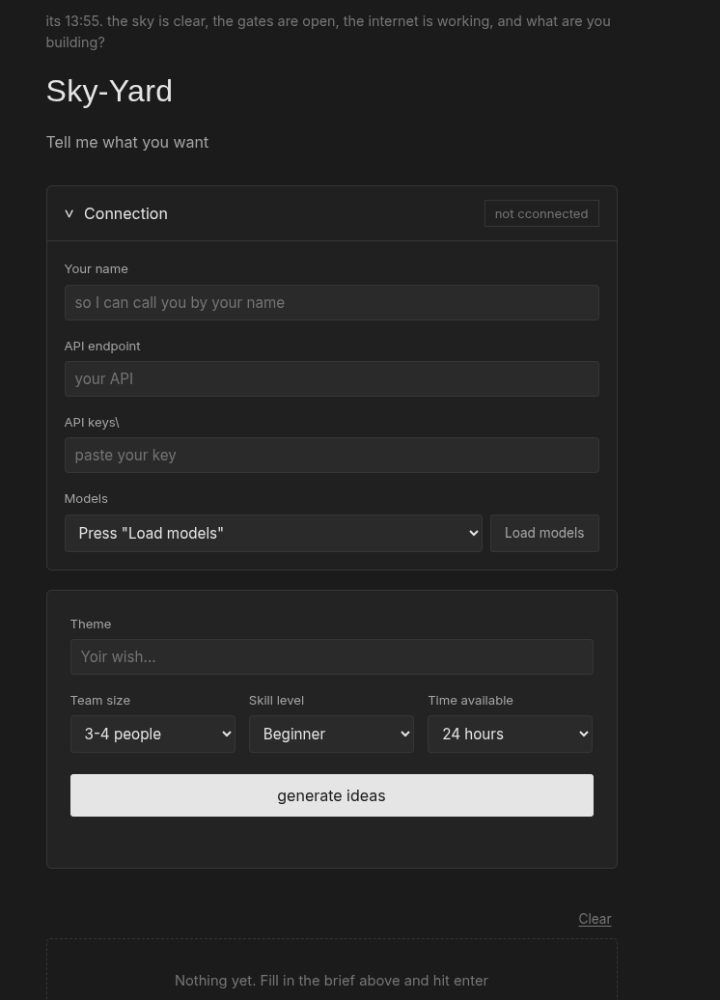

## SkyYard - An idea Generator 

## Description

Sky-Yard is an Ai powered idea generator, enter the theme, team size, and skill level(i.e, beginner, intermediate, and experienced), and how much time left. The generator gives you 3(In rare cases 1, or 2) ideas, based on this.

## To use 

live demo 
https://crowcrow611.github.io/Idea-Generator/

## What it does

Each idea includes,
  * Name: A title
  * Pitch: a short one line concept
  * Stack: Suggests technologies to build it with
  * Stretch goal: a feature to add, if you finish early 

### Prerequisites

* A good browser
* An internet connection
* A free or paid API from an OPENAI-compatible AI provider

### Installing

* clone the repo
* open index.html in your preferred browser.
  
### Executing program

* Pick any OpenAi-compatible provider
* Sign up, and generate an api key, copy it
* Open SkyYard
* Connect your AI (Open the connection panel and fill in)
* Name is optional, its only to greet you
* API Endpoint is the base url of your provider, for example I will take groq `https://api.groq.com/openai/v1`
* Click Load Models
* Fill in the team, theme, experience, etc
* press generate

### Privacy

Your api key, is only stored in your browser. 

### Story Time
if you are wondering why I have developed this, shirry website, it's all only to get ideas, inspirations. 

### Built with
* html, css and javascript.

### Screenshot 

